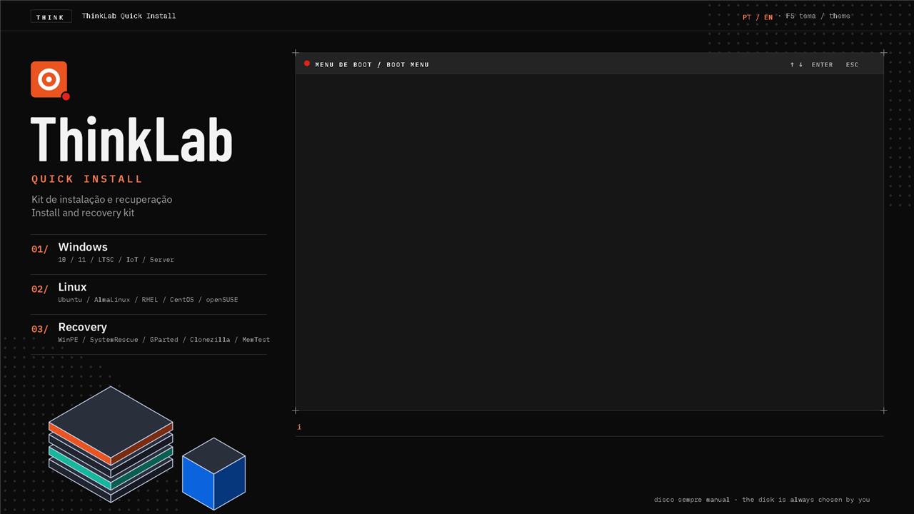

# ThinkLab design reference

One visual language for every ThinkLab surface: this web app, the Quick Install add-on (boot menu, offline manual,
wallpapers) and the diagrams used in documentation. This folder is a **reference pack**; the web app adopted it on 2026-11-20/22 (see
'Adopting it in this app' at the end). The source of truth is `tokens.json`; everything else here is derived from it or shows it in use.

| File | What it is |
|---|---|
| `tokens.json` | Palette as Material-style roles, dark and light, with per-surface overrides (`menu`, `docs`, `desktop`, `diagram`) |
| `tokens.css` | The same tokens as CSS custom properties (`--tl-*`), dark by default, light by `data-theme="light"` or the system setting |
| `examples/identity-layer.css` | The identity layer used by the Quick Install manual: halftone background, numbered sections, code panel, rail, status pill |
| `examples/isometric-*.svg` | Isometric exploded-view diagrams (theme-aware SVG) |
| `examples/boot-menu-*.png`, `examples/wallpaper-*.png` | The same language on other surfaces |

## Where the name comes from

ThinkLab nods to the black business laptops of the IBM era: matte black, one red dot, plain engineering type and the
word THINK. Four things carry that everywhere:

- **Matte black / paper white.** Flat, solid surfaces. No gradients on UI, no drop shadows as decoration.
- **The red dot** (`nub`, `#E2231A`). One small red circle per composition: next to the wordmark, as the bullet of a
  section bar, as the marker on a diagram label. Never a large red area.
- **Brand orange** (`seed.brand`, `#E95420`). The action and highlight colour: primary buttons, the selected row, the brand tab.
- **The THINK tag.** A small outlined box with letter-spaced mono capitals, used once in a header.

## Colour

Roles, not raw colours. Use the role that says what the element is, and let the scheme decide the value.

| Role | Dark | Light | Use |
|---|---|---|---|
| `background` | `#111111` | `#FAFAFA` | page |
| `surface` / `surfaceHigh` | `#1B1B1B` / `#262626` | `#FFFFFF` / `#EFEFEF` | cards, panels / fields, selected rows |
| `onSurface` / `onSurfaceVariant` | `#F3F3F3` / `#A8A8A8` | `#1B1B1B` / `#5F5F5F` | text / secondary text |
| `outline` | `#3A3A3A` | `#D0D0D0` | 1 px borders and rules |
| `primary` / `onPrimary` | `#FF7A4D` / `#1A0A04` | `#D84315` / `#FFFFFF` | actions, links that act, highlights |
| `secondary` | `#5AA7FF` | `#0B64DD` | navigation links |
| `tertiary` | `#3DD6B5` | `#0E8F78` | success, healthy |
| `warning` / `error` | `#F0B24A` / `#FF6B5E` | `#8A5300` / `#B3261E` | status |
| `nub` | `#E2231A` | `#E2231A` | the red dot |

Accent seeds for diagrams and data (same in both schemes): orange `#E95420`, blue `#0B64DD`, teal `#16B79A`,
pink `#F04E98`, yellow `#FEC514`, navy `#101C3F`. The "sunset" stripe band uses yellow, `#FF8A2B`, orange, pink and `#7A3FA0`.

Every surface ships in **dark and light**, and every text is written in **Portuguese and English**.

## Type

| Family | Role | Notes |
|---|---|---|
| IBM Plex Sans (400, 600) | body, UI | replaces Ubuntu Sans when the app adopts the pack |
| IBM Plex Mono (400, 600) | page titles, section bars, labels, code, data | upper-case with letter-spacing for small labels |
| Barlow Condensed (600, 300) | wordmark and large display text | "ThinkLab" is always set in the SemiBold |

All three are SIL OFL. In this app use the `@fontsource/*` packages; the Quick Install repository bundles the TTF files
for offline use.

## Components

- **Numbered section bar.** `01/ Title` in mono inside a ruled bar; the number is `primary`, a red dot sits at the right edge.
- **Panel with crosshair corners.** 1 px `outline` border and a small `+` at two corners; no radius larger than 4 px.
- **Code panel.** Dark in both schemes, a `File: name` header, line numbers in the gutter.
- **Rail.** A vertical pill fixed at the left edge with the language switch (PT / EN), the red dot and the theme toggle.
- **Status pill.** Rounded outline, a coloured dot and a short mono label (for example an integrity or health state).
- **Granular background.** Two offset dot grids (halftone) that fade away from a corner; behind content only, never under text blocks.

## Graphics

- **Isometric exploded views** explain structure: a foundation cube, a stack of thin labelled slabs, a dashed plane, one or
  two accent cubes on top. Accent colour paints the two side faces; the top face stays light. Labels are mono capitals on a
  leader line that ends in the red dot. The generator is `src/tools/Diagrams.ps1` in `thinklab-quickinstall`; it emits
  inline SVG driven by the same tokens.
- **Line art** for hardware: thin lines on matte grey or paper, parts spread on the right, the wordmark bottom left.
- **Tape graphics** for covers and wallpapers: flat stripe bands or one diagonal block, large condensed label.

## Adopting it in this app (done)

`src/styles.css` already uses custom properties, so adoption is a mapping exercise:

| Current variable | Token |
|---|---|
| `--bg` | `--tl-background` |
| `--surface` | `--tl-surface` |
| `--field` | `--tl-surface-high` |
| `--text` / `--muted` | `--tl-on-surface` / `--tl-on-surface-variant` |
| `--border` | `--tl-outline` |
| `--brand` | `--tl-seed-brand` |
| `--link`, `--accent` | `--tl-secondary` |
| `--ok`, `--positive` | `--tl-tertiary` |
| `--warn` | `--tl-warning` |
| `--danger-text` | `--tl-error` |
| `--nav-bg` | `--tl-nav-bar` |

What the app took, decided with the owner:

- **Done:** IBM Plex Sans/Mono and Barlow Condensed; the palette (`src/tokens.css` is a copy of `tokens.css` and `styles.css` maps its variables to the roles above); the rail with the language and theme switch and the red dot; the status pill; the numbered section bars, only on the sections that sit loose on a page (not on cards, forms or detail panels); the halftone background, only on the sign-in screen; the topology impact colours from the red, orange and yellow seeds.
- **Contrast:** the light primary (4.4:1) and teal (4.0:1) read under 4.5:1 on white, so the app mixes in a little of the text colour (5.0:1 and 5.4:1); the pack is unchanged. The impact colours read 4.8:1 or more under the text colour in both schemes.
- **Not adopted:** the THINK tag, the crosshair corners of panels and the code panel with line numbers.

## Keeping the two projects aligned

`tokens.json` here is a copy of `config/design.json` in `thinklab-quickinstall`. Change the palette in one place and copy
the file to the other; `tokens.css` is regenerated from it. No third-party artwork or screenshots belong in either repository.
